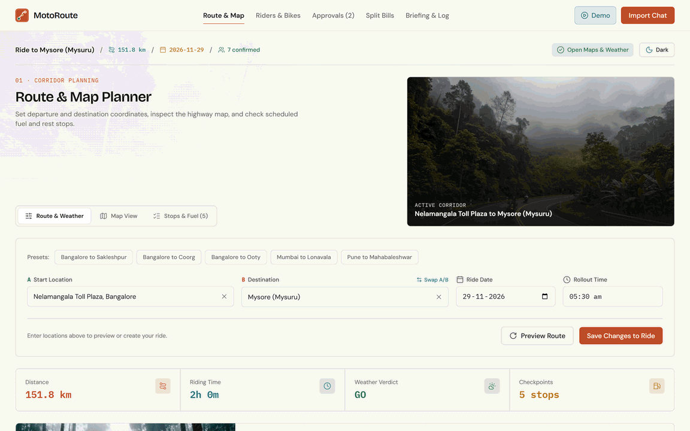
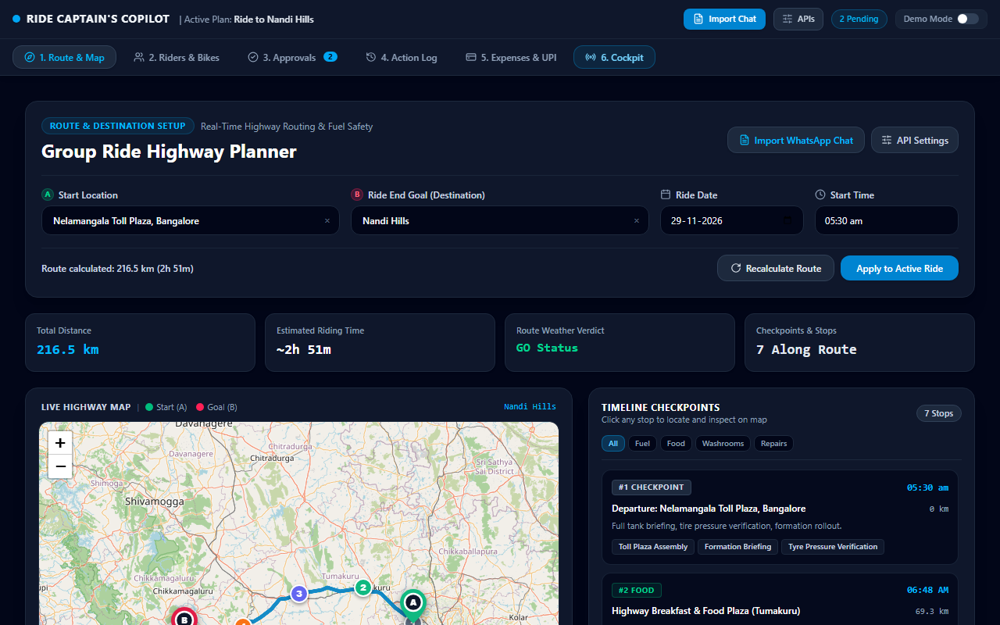
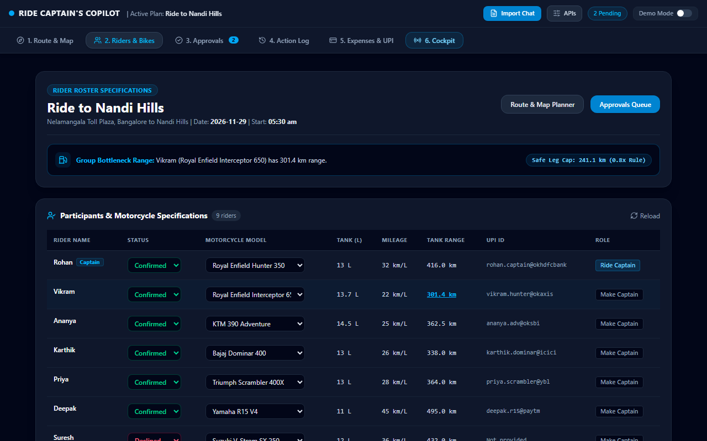
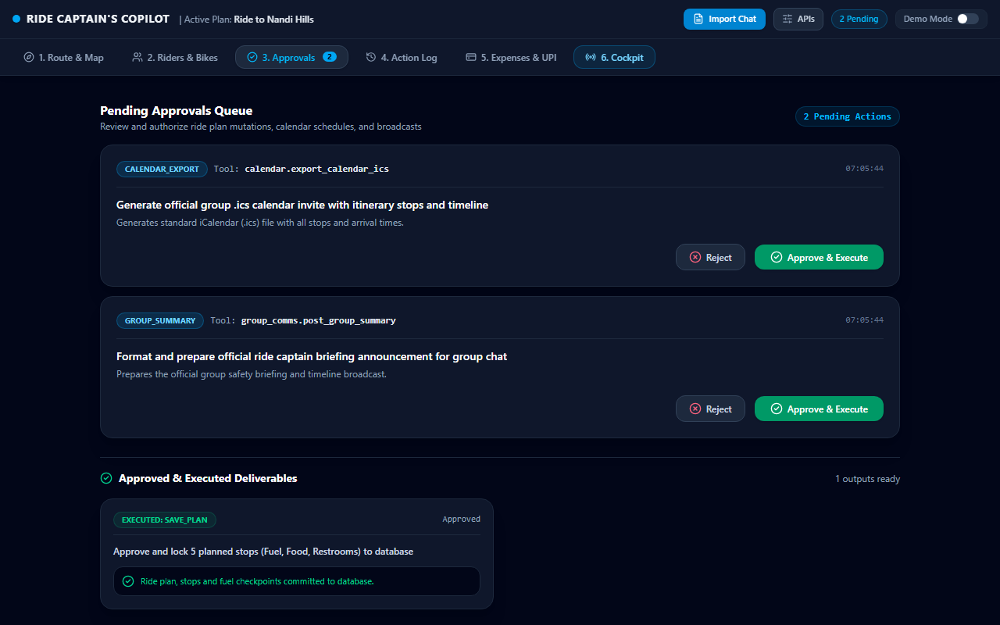
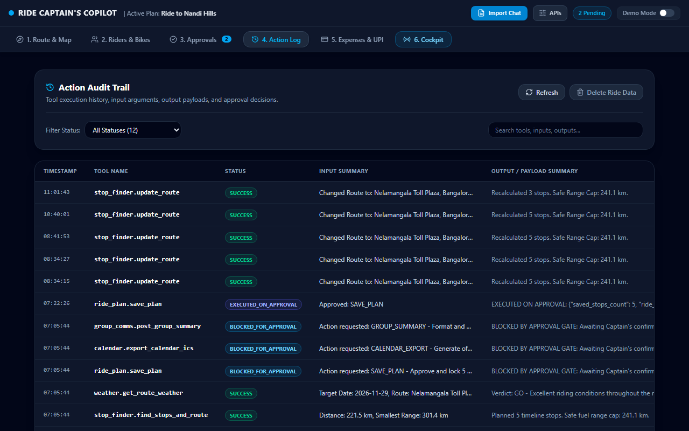
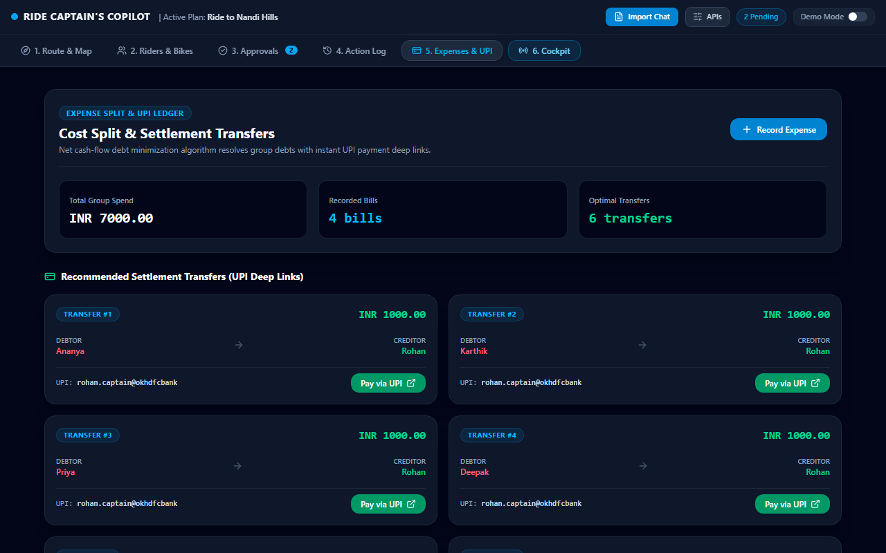
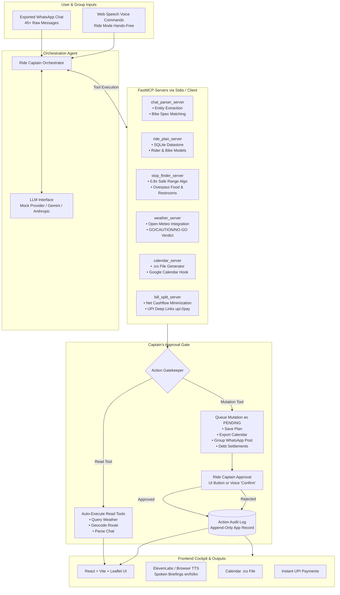

# 🏍️ Ride Captain's Copilot

> **An MCP-powered agent that turns a motorcycle group's messy WhatsApp chat into an approved, safe ride plan: routed, fuelled, fed, and cost-split — with the ride captain always in control.**

[](#)
[](#)
[](#)
[](#)
[](#)
[](#)
[](#)
[](#)
[](LICENSE)

---

## 🎯 The Problem

Organizing a weekend motorcycle group ride is exhausting:
1. **Chat Chaos:** You have to manually comb through 40+ WhatsApp messages with jokes, dropouts, conflicting start points, and food preferences.
2. **The Bottleneck Bike Danger:** Generic route planners treat all vehicles equally, ignoring each motorcycle's tank range. If one rider runs an **Interceptor 650** with a 13.7L tank while another rides an **XPulse 200**, planning fuel stops based on averages leaves someone stranded in a remote ghat section with no network.
3. **Loss of Control:** Typical AI agents act like black boxes — they book, email, or broadcast without human verification. Ride captains need **uncompromising control** over group announcements, route changes, and expense settlements.

**Ride Captain's Copilot** solves this by uniting **6 discrete FastMCP servers** behind an **approval gate: no write action runs without captain approval** and an **append-only audit log in the app**.

---

## 📸 Screenshots & Demo Walkthrough

### 🎬 Full Flow Demo Walkthrough


---

### 🖼️ Real App Screenshots

| 1. Route Planning & Interactive Map | 2. Parsed Roster & Bottleneck Detection |
| :---: | :---: |
| [](docs/images/01_route_map.png) | [](docs/images/02_riders_specs.png) |
| *Interactive Leaflet highway route, custom stop pins (Fuel ⛽, Food 🍔, Restroom 🚻, Service 🔧), and weather verdict.* | *Extracted riders, Indian motorcycle tank matching, and group safe range bottleneck calculation.* |

| 3. Captain's Approval Gate | 4. Action Audit Log (Append-Only) |
| :---: | :---: |
| [](docs/images/03_approvals_gate.png) | [](docs/images/04_action_log.png) |
| *No write action executes without captain sign-off (`SAVE_PLAN`, `CALENDAR_EXPORT`, `GROUP_SUMMARY`, `SETTLEMENT_LINKS`).* | *Real-time append-only log of every MCP tool invocation, inputs, outputs, timestamps, and caller.* |

| 5. Expenses & UPI Deep Links |
| :---: |
| [](docs/images/05_expenses_upi.png) |
| *Shared expense ledger with greedy cash-flow minimization and instant `upi://pay` deep links.* |

---

### 📋 Feature Matrix & Telemetry Behavior

| Feature / Screen | Capabilities | Live Mode (with keys/online) | Demo Mode (zero keys/offline) |
|---|---|---|---|
| **1. Chat Import** | Import raw WhatsApp chat logs or one-click 45-message sample chat | Live LLM (Gemini / Anthropic) with schema validation | Deterministic mock parser for instant zero-key testing |
| **2. Parsed Roster** | Extracted confirmed, undecided, and declined riders with bike matching | Real-time Indian motorcycle database lookup & safe range algorithm | Same local motorcycle specs db (Royal Enfield, KTM, Triumph, etc.) |
| **3. Route & Stops** | Leaflet map with stop pins (Fuel, Food, Restroom, Repair) + weather | Live OpenRouteService geometry + Live Open-Meteo weather | Pre-cached Bangalore–Sakleshpur route, real Nominatim reverse geocode |
| **4. Approvals Gate** | Approval gate: no write action runs without captain approval | Live interceptor: blocks writes until captain clicks Approve or Rejects | Same live approval state machine; produces live `.ics` and broadcast |
| **5. Action Log** | Append-only audit log in the app with filtering and execution details | Live SQLite audit logging of every MCP tool call, input, and response | Same live SQLite append-only audit trail in the app |
| **6. Expenses & UPI** | Group expense ledger, greedy cashflow minimization ($O(N)$ transfers) | Live computation + generates authentic `upi://pay` deep links | Live computation + generates authentic `upi://pay` deep links |
| **7. Cockpit / Ride Mode**| Voice-first cockpit with hands-free STT and multilingual TTS | Live ElevenLabs multilingual speech + Web Speech STT | Native browser Web Speech API (zero keys required) |

---

## 🏗️ Architecture Diagram



---

## 🛡️ "Controlled by Design": Why This Makes MCP Matter

In agentic systems, giving LLMs write permissions often results in irreversible accidents. **Ride Captain's Copilot implements a strict binary permission model**:

1. **Autonomous Read Discovery (Zero Latency)**:
   - Tool calls that fetch information run freely: parsing messages, geocoding waypoints, polling Open-Meteo weather, and computing cash-flow balances.
2. **Gated Mutations (Zero Risk)**:
   - Any tool that produces an external side-effect is intercepted by the **approval gate: no write action runs without captain approval**:
     - `SAVE_PLAN`: Writing stops to database.
     - `CALENDAR_EXPORT`: Generating official calendar invites.
     - `GROUP_SUMMARY`: Preparing official ride broadcasts.
     - `SETTLEMENT_LINKS`: Publishing binding financial transfer links.
3. **Append-Only Audit Log in the App**:
   - Every single tool invocation, whether auto-read, blocked, approved, or rejected, is permanently recorded in the app's append-only SQLite log and rendered in the UI with timestamps and actor designations.
4. **Hands-Free Voice Approval**:
   - On the road in Ride Mode, the captain can say **"Confirm"** or **"Cancel"** into helmet communications to approve or reject pending actions without taking gloves off.
5. **One-Click Privacy**:
   - Group chat text is scoped strictly to that ride and can be completely wiped from the database with a single click.

---

## 🧮 Algorithms & Core Capabilities

### 1. The Fuel Bottleneck Algorithm ($0.8 \times \text{Smallest Tank Range}$)
$$\text{Safe Leg Limit} = 0.8 \times \min_{r \in \text{Confirmed}} (\text{Tank Litres}_r \times \text{Mileage}_r)$$
- Extracts motorcycle models from chat and cross-references an Indian motorcycle database (Royal Enfield Himalayan 450, Interceptor 650, Hunter 350, KTM 390 Adventure, Dominar 400, Splendor Plus, etc.).
- On the Bangalore ➡️ Sakleshpur sample route, Rahul's Interceptor 650 ($13.7\text{ L} \times 22\text{ kmpl} = 301.4\text{ km}$) yields a safe leg cap of **241.1 km**.
- Places a mandatory fuel stop at **Hassan Bypass (182.4 km)** before entering the ghats.
- If any station gap exceeds the safe range, it triggers a **CRITICAL WARNING** in the plan.

### 2. Overpass Places & Restroom Coverage (Every 60 km or less)
- Places breakfast stops in typical morning meal windows (7:00 am – 8:30 am, matching chat food preferences like Swathi Delicacy Thatte Idli).
- Enforces comfort stops so no highway stretch exceeds 60 km without a clean restroom.
- Maps authorized motorcycle service centers and tire puncture shops as safety nets.

### 3. Open-Meteo Weather Verdict
- Evaluates rain probability, wind speeds, and WMO thunderstorm codes in plain text:
  - **NO-GO**: Thunderstorm codes (95, 96, 99), rain probability 70% or more, or wind speed 45 km/h or more.
  - **CAUTION**: Rain probability between 40% and 69%, or wind speed between 30 and 44 km/h.
  - **GO**: Rain probability under 40% and wind speed under 30 km/h.

### 4. Greedy Cashflow Settlement & UPI Deep Links
- Balances are guaranteed to sum to zero ($\sum B_i = 0$).
- Resolves all debts in at most $N - 1$ transfers.
- Generates standardized UPI payment deep links:
  `upi://pay?pa={upi_id}&pn={name}&am={amount}&cu=INR&tn=Ride_Settlement`

---

## 🛠️ Tech Stack

| Component | Technology | Rationale |
|---|---|---|
| **Backend** | Python 3.11+, FastAPI, Pydantic v2 | High-performance async API with strict type validation |
| **Database** | SQLite via SQLAlchemy | Zero-config, ACID-compliant local storage |
| **MCP** | Official `mcp` SDK (FastMCP / MCPServer) | Native tool definition and client-server stdio execution |
| **Agent Core** | Mock Provider / Gemini / Anthropic | Pluggable LLM interface; 100% offline-capable with Mock |
| **Frontend** | React 19, Vite 6, TypeScript, Tailwind CSS v4 | Ultra-responsive, mobile-friendly cockpit UI |
| **Mapping** | Leaflet & OpenStreetMap | Open-source interactive map without proprietary tile keys |
| **Voice** | ElevenLabs Multilingual TTS + Web Speech API | Multi-language briefings (en, hi, kn) + browser voice STT |
| **External APIs**| Open-Meteo (Weather), OSM Overpass (Places), iCalendar | Rich real-world telemetry with offline demo caching |

---

## ⚡ Quickstart (Under 5 Commands, 0 Keys Needed!)

### 1. Clone the repository
```bash
git clone https://github.com/praveenkumar0500y/BAROQUE-WORKS.git
cd BAROQUE-WORKS
```

### 2. Install dependencies
```bash
pip install -r requirements.txt
cd frontend && npm install && cd ..
```

### 3. Run the complete application in Demo Mode
```bash
python run_demo.py
```
*(Or use `make demo` if `make` is installed)*

**That's it!** Open **http://localhost:5173** in your browser. The mock provider and cached telemetry work 100% offline without any API keys.

---

## ⚙️ Environment Variables

Copy `.env.example` to `.env` to configure optional external services:

| Variable | Default | Description |
|---|---|---|
| `DEMO_MODE` | `true` | When true, uses deterministic mock LLM & cached high-fidelity OSM/Weather |
| `LLM_PROVIDER` | `mock` | Options: `mock` (zero keys), `gemini`, or `anthropic` |
| `GEMINI_API_KEY` | `""` | Optional Google Gemini API key |
| `ANTHROPIC_API_KEY` | `""` | Optional Anthropic Claude API key |
| `ORS_API_KEY` | `""` | Optional OpenRouteService key (falls back to cached route) |
| `ELEVENLABS_API_KEY`| `""` | Optional ElevenLabs key for spoken briefings (falls back to browser TTS) |
| `ELEVENLABS_VOICE_ID`| `21m00Tcm4TlvDq8ikWAM` | Voice ID for ElevenLabs multilingual speech |
| `DATABASE_URL` | `sqlite:///./ride_copilot.db`| SQLite database connection string |

---

## 🧪 Running Unit Tests

All algorithms (fuel stop calculation, settlement minimisation, WhatsApp parsing, approval gate enforcement, weather verdict thresholds) are covered by pytest:

```bash
python -m pytest backend/tests -v
```

**Test Results:**
```
backend/tests/test_approval_gate.py::test_approval_gate_blocks_write_action PASSED
backend/tests/test_approval_gate.py::test_approval_gate_rejection PASSED
backend/tests/test_chat_parser.py::test_whatsapp_parser_sample_chat PASSED
backend/tests/test_fuel_stop_algorithm.py::test_fuel_stop_algorithm_safe_range PASSED
backend/tests/test_fuel_stop_algorithm.py::test_fuel_stop_algorithm_flags_gap_warning PASSED
backend/tests/test_settlement_minimisation.py::test_settlement_balances_sum_to_zero_and_minimal PASSED
backend/tests/test_weather_verdict.py::test_weather_verdict_go PASSED
backend/tests/test_weather_verdict.py::test_weather_verdict_caution PASSED
backend/tests/test_weather_verdict.py::test_weather_verdict_no_go PASSED
======================= 9 passed in 2.9s =======================
```

---

## 🗺️ Roadmap

- [x] WhatsApp group chat parser (LLM + regex fallback)
- [x] Indian motorcycle tank database & safe range bottleneck calculator
- [x] Route & stop planner with OpenStreetMap Overpass amenities
- [x] Open-Meteo timeline weather hazard assessment
- [x] Captain's Approval Gate & Action Audit Log
- [x] Net debt minimization & Indian UPI deep links
- [x] Voice-first Ride Mode cockpit with ElevenLabs & Web Speech API
- [ ] **Roadmap:** Live GPS tracking via WebSockets for real-time rider distance telemetry
- [ ] **Roadmap:** Bluetooth intercom bridge (Sena / Cardo mesh network integration)
- [ ] **Roadmap:** Direct WhatsApp Business Cloud API integration for automated one-click broadcast dispatch upon approval

---

## 📄 License

This project is licensed under the [MIT License](LICENSE).
