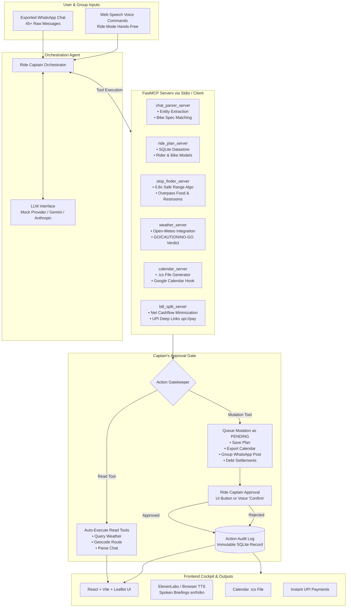

# Architecture: Ride Captain's Copilot

## High-Level System Architecture

---

## Controlled by Design: The Approval Gate

In conventional agent workflows, agents often hallucinate or execute irreversible write actions autonomously. **Ride Captain's Copilot** solves this by establishing a strict architectural division:

1. **Autonomous Read Discovery (Zero Friction)**:
   - Extraction of chat messages (`chat_parser.parse_whatsapp_chat`)
   - Weather hazard analysis (`weather.get_route_weather`)
   - Route distance and stop proposals (`stop_finder.find_stops_and_route`)
   - Expense calculations (`bill_split.compute_settlement`)

2. **Mandatory Captain Authorization (High Stakes)**:
   - **`SAVE_PLAN`**: Committing stops and locking itineraries to the database.
   - **`CALENDAR_EXPORT`**: Generating group invites and scheduling files.
   - **`GROUP_SUMMARY`**: Broadcasting safety briefings to the WhatsApp chat.
   - **`SETTLEMENT_LINKS`**: Publishing binding financial transactions and debt transfers.

Every mutation is tagged as `PENDING` and presented with an explanatory payload in the UI and voice cockpit. The Ride Captain can confirm or reject via one click or by speaking **"Confirm"** / **"Cancel"**.

---

## Safe Fuel Stop Calculation Algorithm ($0.8 \times \min(Range)$)

Motorcycle group rides are inherently limited by the rider with the smallest fuel tank capacity.
$$\text{Safe Range} = 0.8 \times \min_{r \in \text{Confirmed}} (\text{Tank Litres}_r \times \text{Mileage}_r)$$

For the Bangalore to Sakleshpur route:
- Rahul's **Royal Enfield Interceptor 650** ($13.7\text{ L} \times 22\text{ kmpl} = 301.4\text{ km}$).
- $\text{Safe Range} = 0.8 \times 301.4 = \mathbf{241.1\text{ km}}$.
- The algorithm places a mandatory refuel at **Hassan Bypass (182.4 km)** to guarantee that all riders enter the Western Ghats twisties on full tanks with safety buffers.
- If a route segment exceeds the safe threshold without an available fuel station, the algorithm surfaces a **CRITICAL WARNING** to the Captain.

---

## Net Debt Minimization & UPI Payments

Given $N$ riders with expenses $E_k$, net balance is calculated:
$$B_i = \sum \text{Paid}_i - \sum \text{Share}_i \quad \text{where } \sum_{i=1}^N B_i = 0$$

A greedy matching algorithm repeatedly matches the maximum debtor with the maximum creditor, resolving all balances in at most $N - 1$ transactions. Each transaction generates a standardized Indian UPI deep link:
`upi://pay?pa={upi_id}&pn={name}&am={amount}&cu=INR&tn=Ride_Settlement`
